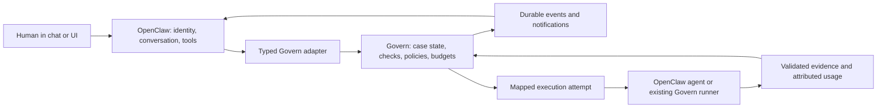

# OpenClaw over Govern: capability gap and integration plan

> **Snapshot as of `9bf5bd3` (2026-10-14), not maintained.** Persistent conversations, the remote API and signed device approvals have since shipped; see [CONVERSATIONS.md](CONVERSATIONS.md) and [REMOTE.md](REMOTE.md). The comparison below records the research baseline.

Research date: 2026-10-14. “OpenClaw” means [openclaw/openclaw](https://github.com/openclaw/openclaw). This assessment compares its current upstream documentation with Govern's local implementation, including the unpushed loops and dynamic branching work. It is a documentation and source review, not a deployed integration or performance benchmark. Upstream `main` is mutable; the pages below were retrieved for this review.

## Recommendation

Use OpenClaw for conversations, agent sessions, tools, and delivery. Keep Govern authoritative for business case state, process revisions, transitions, checks, human decisions, and Govern-managed budgets. Build a narrow integration between them rather than reproducing OpenClaw inside Govern.

Govern's purpose explicitly excludes acting as a chat assistant. Its existing features make it a useful governance backend, but neither its workflow graph nor its headless agent queue supplies a messaging platform or persistent assistant runtime.

OpenClaw is also more than a chat interface: its Gateway owns sessions, tools, events, and channels; it supports external harnesses, recurring automations, and resumable approval workflows through Lobster. The two products overlap in orchestration and approvals, so state ownership must be explicit.

## Capability comparison

| Area | OpenClaw documents | Govern currently provides | Gap and suggested owner |
| --- | --- | --- | --- |
| Chat channels | Messaging adapters, sender pairing, room access and agent routing | CLI, owner/task inboxes; generic loopback event ingress | Reuse OpenClaw channels; add case/thread bindings and actor mapping. |
| Control plane | Long-lived Gateway, typed WebSocket RPC and pushed events | CLI, dispatcher service, timer loop, small HTTP event receiver | Add a typed Govern adapter/service contract, not another general assistant gateway. |
| Assistant continuity | Persistent sessions, identities, memory files and memory search | Case files, notes, briefs, session records; fresh headless sessions per queued task | Reuse OpenClaw sessions and retrieval. Treat retrieved context as evidence, not approved case state. |
| Agent routing and execution | Multiple agent workspaces, conversation routing, delegated runs and ACP/native harness paths | Profiles, capability grants, custom queue runners, Claude/Codex/Grok dispatch | Map stages to named agents and map runs/results back to Govern attempts. Prevent duplicate execution ownership. |
| Tools and extensions | Skills, plugins, managed browser, device nodes, provider tools | Named commands, profiles, engine-specific permission mapping and secret names | Reuse tool ecosystem; explicitly constrain which tools/effects each Govern stage may authorize. |
| Scheduling and delivery | Durable automations, heartbeat, channel/webhook delivery | Durable stage deadlines, retries, local alerts and `tick --advance` | Add notification outbox and delivery receipts. Keep business deadlines in Govern; use OpenClaw for wakeups and delivery. |
| Approvals and identity | Operator scopes/roles, exec/plugin approval APIs, authenticated team access, Lobster checkpoints | Human quotes from terminal/Claude, OS-user process people, quorum/separation/expiry | Add trusted external decision provenance. OpenClaw operator permission must not automatically count as a business vote. |
| Operator UI | Browser Control UI for conversations, sessions and operations | Text `desk`, `status`, `brief`, usage and ledger views | Expose case status, evidence and business decisions in a UI alongside conversations. |
| Models and recovery | Provider selection, authentication rotation and configured model fallback | Engine/model profiles, queue verification; business retry policies | Reuse OpenClaw model runtime when chosen; preserve run attribution and Govern's independent output checks. |
| Execution isolation | Configurable sandbox backends and tool policies | Harness sandbox/permission configuration, resource locks and grants | Compose policies. Govern capability descriptions alone do not provide a universal isolation boundary. |
| Workflow controls | Lobster typed pipelines, durable approval/input checkpoints and resume tokens | Typed case data; exclusive/inclusive routes; parallel joins; bounded/nested loops; per-item child cases; timers/events; stage-check retries/compensation; pinned revisions/migrations | Preserve Govern as business workflow authority. Do not run the same approval or transition independently in both engines. |
| Accounting | Agent/session runtime and operational views | Lane ledger, token/cost reporting, machine accounting and allowances on covered execution paths | Import external usage and reserve budgets before external dispatch. OpenClaw runs currently bypass Govern accounting unless adapted. |

OpenClaw's documented team model is one trusted Gateway domain, with roles and collaboration controls. It does not promise isolation between mutually untrusted tenants; its documentation recommends separate gateways for those tenants. Govern's OS-user identities and shared workspace event token likewise do not establish enterprise tenant isolation.

## Five highest-value additions for the combined system

### 1. Typed Govern tools/API adapter

Expose structured operations for process discovery, case creation/status, case-data changes, active work, evidence submission, events, and permitted advancement. Reuse Govern's validation and locking paths. Give requests idempotency keys and explicit case/process revision or stage generation where applicable. A skill with shell instructions can prototype this, but it is not a stable API contract or an identity boundary.

Success criterion: an OpenClaw agent creates and progresses a case through typed results, and a repeated request does not duplicate a case or side effect. Existing gates and checks still reject premature advancement.

### 2. Authenticated external approvals and people mapping

Map authenticated channel/operator identities to process people. A trusted adapter must capture the human's message ID, actor, channel, time, decision, target gate and case version. Bind approvals to the reviewed data and reject stale or replayed decisions. Keep credentials and decision-signing authority outside model-controlled payloads. Extend Govern's decision-source contract rather than asking the model to supply a convincing quote.

This is a concrete blocker: `approval.ts` recognizes terminal and Claude transcript sources; `business.ts` resolves process people through the OS account. An OpenClaw chat sender is not currently a supported source. A daemon issuing `govern approve --quote ...` could be classified as the daemon's terminal user without establishing who approved in chat.

Success criterion: two people on one Gateway produce two separately attributed votes; requester exclusion, quorum, expiry, and changes to reviewed data remain enforced. A generated assistant message cannot supply a human vote.

### 3. Durable events and notification outbox

Publish committed case events such as stage-ready, approval-required, deadline-due, child-finished, blocked and completed. Persist outbound messages with stable IDs, attempts, delivery receipts and a retry/dead-letter policy. Retain event-ingress deduplication and generation checks already in Govern. Polling can be the first transport, but the contract must survive restarts and allow replay.

Success criterion: an escalation reaches the correct conversation after a delivery outage; replay does not create duplicate decisions or transitions. Delivery acknowledgment never substitutes for approval.

### 4. Stage-to-agent execution adapter

Declare the stage's agent/profile, execution workspace, allowed tools, input brief, output schema/checks and budget. Persist the mapping from case/stage generation/attempt to OpenClaw session/run. Dispatch once, record failures and cancellation explicitly, and validate results before case advancement. Choose either Govern's queue or OpenClaw's runtime as execution owner for each task.

Success criterion: parallel and per-item work runs through mapped agents within the intended concurrency/budget limits, and restarting either service neither loses nor repeats an uncertain external action. A chat reply or successful model turn alone does not mark business work complete.

### 5. Combined case operations and audit view

Provide case timelines, active branches, loop iterations, pending humans, check evidence, retries, child cases, blocked reasons and cost. Link each conversation and agent run to its case attempt. Surface operator actions with the authenticated human's identity and record business decisions in Govern's ledger.

Success criterion: an operator can explain why a case is blocked, inspect the artifact under review, decide within their process role, and trace the resulting run and cost without reading raw state files.

These are integration priorities, not an instruction to implement them. For a standalone Govern assistant platform, persistent sessions/memory, channels, provider runtime, browser/device tools and the Gateway would also be major projects. Reusing OpenClaw avoids that separate product build.

## Proposed ownership and flow

Example: a person requests a purchase in Slack. OpenClaw gathers the request and calls Govern to create the case. Govern selects reviews from typed data, dispatches mapped agent work, and asks the correct people for decisions through the outbox. The trusted adapter records each human's authenticated vote. Govern checks quorum, evidence and current case state before authorizing the next step. OpenClaw performs the authorized tool work and returns its result and usage.

Use Lobster for a bounded tool pipeline within a stage if useful. Decide whether its checkpoint is an execution permission or the business approval; do not silently equate them. Govern remains authoritative for the overall case.

## Remaining BPM limits

OpenClaw integration would improve interaction and execution, not automatically fill all BPM requirements. Govern still has flat scalar collections rather than nested records/forms, constrained inclusive branches, bounded rather than unrestricted loops, no BPMN/DMN import or visual designer, and no distributed workflow service with tenant isolation. These are distinct decisions from OpenClaw feature parity.

## Evidence and sources

Govern implementation reviewed:

- [Purpose](PURPOSE.md), [business workflows](BUSINESS.md), [durable lifecycle](LIFECYCLE.md), [new iteration capabilities](ITERATION.md), [operator manual](SKILL.md).
- [Human approval provenance](lib/approval.ts), [people and policy enforcement](lib/business.ts), [profiles and capability mappings](lib/caps.ts), [queue and runners](lib/queue.ts).
- [Event receiver](ext/business/event-server.ts), [lifecycle execution](lib/lifecycle.ts), [per-item execution](lib/fanout.ts), [allowances](lib/allowances.ts), [text desk](lib/desk.ts).

OpenClaw primary documentation retrieved from upstream `main`:

1. [README](https://github.com/openclaw/openclaw/blob/main/README.md) and [Gateway architecture](https://docs.openclaw.ai/concepts/architecture).
2. [Channels](https://docs.openclaw.ai/channels), [multi-agent routing](https://docs.openclaw.ai/concepts/multi-agent), [sessions](https://docs.openclaw.ai/concepts/session), [memory](https://docs.openclaw.ai/concepts/memory).
3. [Team setup](https://docs.openclaw.ai/start/teams), [operator scopes](https://docs.openclaw.ai/gateway/operator-scopes), [security trust model](https://docs.openclaw.ai/gateway/security/trust-model), [sandboxing](https://docs.openclaw.ai/gateway/sandboxing).
4. [Automations](https://docs.openclaw.ai/automation/cron-jobs), [heartbeat](https://docs.openclaw.ai/gateway/heartbeat), [Control UI](https://docs.openclaw.ai/web/control-ui).
5. [Lobster](https://docs.openclaw.ai/tools/lobster), [exec approvals](https://docs.openclaw.ai/tools/exec-approvals), [skills](https://docs.openclaw.ai/tools/skills), [browser](https://docs.openclaw.ai/tools/browser), [nodes](https://docs.openclaw.ai/nodes).
6. [ACP agents](https://docs.openclaw.ai/tools/acp-agents), [agent send](https://docs.openclaw.ai/tools/agent-send), [model failover](https://docs.openclaw.ai/concepts/model-failover).

The priorities, division of ownership and proposed API are recommendations inferred from the comparison. No end-to-end compatibility, throughput, or production reliability claim is made by this review.
